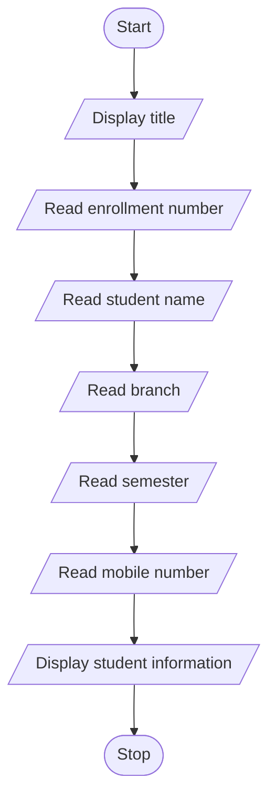

# Practical 2.1 — Student Registration Problem Analysis and Design

## Problem statement

The university needs a Student Record Management System registration module that records and displays student identity and academic placement information.

## Stakeholders

- University administration
- Examination office
- Student
- Software developer

## Inputs

- Enrollment number
- Student name
- Branch
- Semester
- Mobile number

## Processing

1. Accept enrollment number.
2. Accept student name.
3. Accept branch.
4. Accept semester.
5. Accept mobile number.
6. Format the values.
7. Display the student information.

## Expected outputs

- The title and registration heading.
- The entered student details.
- A consistently formatted student information report.

## IPO chart

| Input | Process | Output |
|---|---|---|
| Enrollment number | Store the value | Enrollment number |
| Student name | Store and display the value | Student name |
| Branch | Store and display the value | Branch |
| Semester | Store and display the value | Semester |
| Mobile number | Store and display the value | Mobile number |

## Problem decomposition

```text
Student Record Management System
├── Student Registration
│   ├── Accept Enrollment Number
│   ├── Accept Student Name
│   ├── Accept Branch
│   ├── Accept Semester
│   └── Accept Mobile Number
├── Information Formatting
└── Student Report
```

## Numbered algorithm

1. Start.
2. Display the application title.
3. Display the registration heading.
4. Read enrollment number.
5. Read student name.
6. Read branch.
7. Read semester.
8. Read mobile number.
9. Display a divider.
10. Display all entered details.
11. Stop.

## Pseudocode

```text
START
DISPLAY title
DISPLAY registration heading
READ enrollmentNumber
READ studentName
READ branch
READ semester
READ mobileNumber
DISPLAY student information heading
DISPLAY enrollmentNumber
DISPLAY studentName
DISPLAY branch
DISPLAY semester
DISPLAY mobileNumber
STOP
```

## Flowchart



## Manual dry run

| Step | Enrollment | Name | Branch | Semester | Mobile |
|---|---|---|---|---|---|
| Initial | Empty | Empty | Empty | Empty | Empty |
| Read enrollment | `26CSE001` | Empty | Empty | Empty | Empty |
| Read name | `26CSE001` | `Akshar Patel` | Empty | Empty | Empty |
| Read branch | `26CSE001` | `Akshar Patel` | `CSE` | Empty | Empty |
| Read semester | `26CSE001` | `Akshar Patel` | `CSE` | `1` | Empty |
| Read mobile | `26CSE001` | `Akshar Patel` | `CSE` | `1` | `9999999999` |
| Display report | All values shown | All values shown | All values shown | All values shown | All values shown |

## Existing `p2_1.cpp` verification

`p2_1.cpp` uses the values from the dry run directly and prints the same registration/report structure. It is a static demonstration rather than a user-input implementation. The PDF algorithm and output structure are represented, but no runtime input is accepted.
